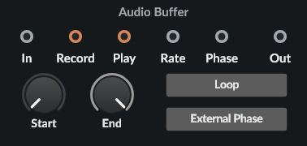

# Bitwig Studio 6.1.7 and later

This folder contains the compressed Nitro builds for Bitwig Studio 6.1.7
and later. See the [installation guide](../README.md#install) for choosing
and registering the matching build.

| Audio FX | Instruments | Note devices |
| --- | --- | --- |
| [Halftime](Halftime.bwdevice) | [FILAR](FILAR.bwdevice) | [Chord Arp](Chord%20Arp.bwdevice) |
| [Multiband FX-4](Multiband%20FX-4.bwdevice) | [Rivet](Rivet.bwdevice) | [Prism](Prism.bwdevice) |
| [Normalizer](Normalizer.bwdevice) | | [Step Sequencer](Step%20Sequencer.bwdevice) |
| [Orbit](Orbit.bwdevice) | | |
| [OTT](OTT.bwdevice) | | |
| [SHARD](SHARD.bwdevice) | | |
| [Stutter](Stutter.bwdevice) | | |

Modulator: [Gesture Loop](Gesture%20Loop.bwmodulator).

All 12 devices and the Gesture Loop modulator passed the offline Nitro
reader check with the Bitwig Studio 6.1.7 macOS arm64 toolchain. The Windows
6.1.7 Nitro reader also accepted the exact embedded payload from Stutter
revision 10. Insertion, controls, audio and project recall still need
verification in Bitwig.

## Grid modules

[Audio Buffer](Audio%20Buffer.bwmodule) records up to 30 seconds of stereo
audio with variable-rate playback, loop regions and external phase control.
The candidate targets monophonic FX Grid and passed offline checks on Windows
Bitwig Studio 6.1.7. Grid insertion, patching, audio and project recall are
pending a live test.

