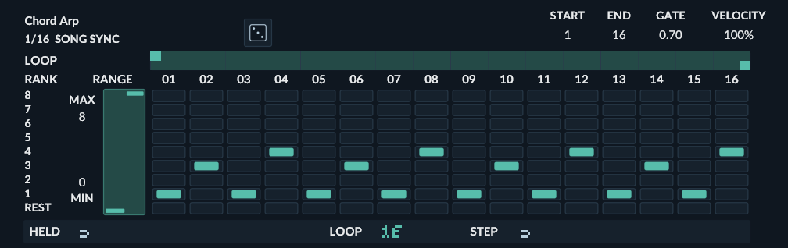
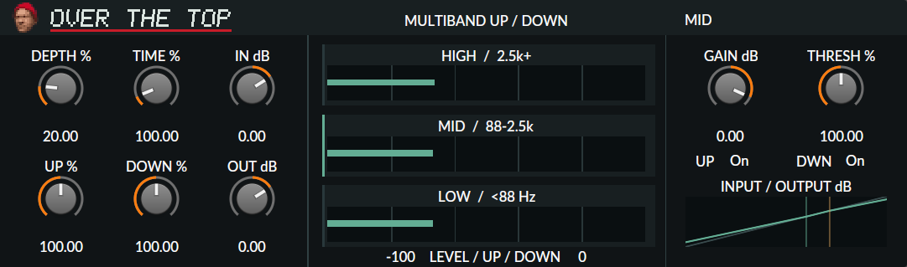

# Polarity Bitwig Devices

Native devices for Bitwig Studio by [Polarity](https://polarity.me/). Put the `.bwdevice` files in a folder scanned by Patchbay Mod Loader.

## Install

1. Download the [Patchbay Mod Loader tester release with the Nitro fix](https://github.com/shaboogen-dev/BML/releases/tag/0.36.0-dev.9%2Bnitro-1.2.0-dev.5) and follow `INSTALL.md` in the ZIP. The [Patchbay Mod Loader repository](https://github.com/shaboogen-dev/BML) and its downloads currently require tester access. The release includes **Custom Nitro Registration** `1.2.0-dev.5`, which fixes project recall for scanned devices.
2. Open a device file below and choose **Download raw file**. To get the whole collection, use **Code → Download ZIP** and extract the `devices` folder. Keep the `.bwdevice` files in a folder of your choice.
3. Close Bitwig. In Patchbay, enable **Framework: Custom Nitro Registration**, then open **Tools → Device Folders** and add the folder containing the files. Click **Load** to launch Bitwig with the framework enabled.
4. In Bitwig, search for the device by name. Place Chord Arp, Prism and Step Sequencer before an instrument.

## Devices

| Device | Type | What it does | Panel |
| --- | --- | --- | --- |
| [Chord Arp](devices/Chord%20Arp.bwdevice) | Note FX | Turn held chords into song-synced arpeggios with a 16-step rank matrix, bounded randomization, and velocity scaling. | [Preview](previews/chord-arp.png) |
| [FILAR](devices/FILAR.bwdevice) | Instrument | An additive synthesizer with 32 editable sine partials, per-partial attack and decay, and 32 generated upper partials. | [Preview](previews/filar.png) |
| [Halftime](devices/Halftime.bwdevice) | Audio FX | Captures tempo-synced audio loops and changes their tape speed for half-time, pitch-shift and stutter effects. | [Preview](previews/halftime.png) |
| [Multiband FX-4](devices/Multiband%20FX-4.bwdevice) | Audio FX | Splits audio into four adjustable bands, each with its own device chain, and shows the band spectra. Optional linear-phase crossover. | [Preview](previews/multiband-fx-4.png) |
| [Normalizer](devices/Normalizer.bwdevice) | Audio FX | Measures short-term loudness and applies one-shot gain correction to a LUFS target, with an optional hard clipper. | [Preview](previews/normalizer.png) |
| [Orbit](devices/Orbit.bwdevice) | Audio FX | Turns audio or internal strikes into ringing textures with modal, sympathetic-string and nonlinear-string resonators. | [Screenshot](previews/orbit.png) |
| [OTT](devices/OTT.bwdevice) | Audio FX | Three-band upward and downward compression that lifts quiet details and controls peaks for a dense, bright sound. | [Screenshot](previews/ott.png) |
| [Prism](devices/Prism.bwdevice) | Note generator | Generates tempo-synced melodies from weighted scale degrees, with looping patterns, rests, swing and motif variation. Place an instrument after it. | [Screenshot](previews/prism.png) |
| [Rivet](devices/Rivet.bwdevice) | Instrument | A monophonic synthesizer with three oscillators, a driven mixer, ladder filter, envelopes, noise and feedback. | [Preview](previews/rivet.png) |
| [SHARD](devices/SHARD.bwdevice) | Audio FX | Shapes audio with 3 to 63 logarithmically spaced spectral gain bands, from broad tonal changes to detailed sculpting. | [Preview](previews/shard.png) |
| [Step Sequencer](devices/Step%20Sequencer.bwdevice) | Note generator | A tempo-synced 16-step note sequencer with per-step gate, velocity, pressure and note rows. Place an instrument after it. | [Preview](previews/step-sequencer.png) |
| [SVF Lab](devices/SVF%20Lab.bwdevice) | Audio FX | A stereo filter research device with low-pass, band-pass and high-pass modes. | — |

## Compatibility and updates

All 12 files passed their Windows x64 Bitwig Studio **6.1.3** offline build checks. The **Custom Nitro Registration** `1.2.0-dev.5` folder scanner also found all 12 and read distinct UUIDs using Bitwig 6.1.3's document reader. This test ran outside the Bitwig application. Live insertion, audio and project recall are still unverified for most of these exact builds. The current OTT file also loaded in a saved project through Patchbay on Windows 6.1.3. macOS, Linux and other Bitwig versions are unverified for this collection.

The current **Chord Arp** is revision 4. Its loop endpoints use a different saved-value type from revision 1. A project saved with revision 1 failed to reopen with revision 4. For a project saved with revision 1, use its matching file from your backup or this repository's first commit. Keep a copy of the files used by your saved projects outside the scanned folders, and relaunch Bitwig through Patchbay after replacing a file.
