# Polarity Bitwig Devices

## Getting started

- **Use the launcher.** On Windows and macOS, install Patchbay in the
  unofficial Patchbay Launcher, then open **Mods** or **Devices** to pick
  what to add. The launcher handles updates for Patchbay, mods, and devices.
  [Download Patchbay Launcher](https://github.com/arius77R/patchbay-launcher/releases)
- **Install manually.** Patchbay Mod Loader patches Bitwig at startup and
  includes the frameworks that mods and devices use. Pick a release that
  supports your Bitwig version and follow `INSTALL.md` in the ZIP.
  [Download Patchbay](https://github.com/shaboogen-dev/Patchbay/releases)

  - Get mod ZIPs from [Patchbay Mods](https://github.com/shaboogen-dev/Mods/releases).
  - Get Polarity's mod ZIPs from [Bitwig Mods](https://github.com/polarity/bitwig-mods/releases).
  - Get Polarity's devices and modulators from [Bitwig Devices](https://github.com/polarity/bitwig-devices#install).

## What's in this repo

My instruments, effects, note generators, modulators, and Grid modules for Bitwig Studio.
[Join the Discord to discuss the devices](https://discord.gg/Z3fEexCRHg).

## Install

For manual setup, choose the folder for your Bitwig Studio version. Grid modules
are packaged alongside devices and modulators in the version folders.

- [Before 6.1.7](Bitwig-6.1.3-6.1.4/README.md): uncompressed Nitro builds for Bitwig 6.1.3 and 6.1.4.
- [6.1.7 and later](Bitwig-6.1.7/README.md): compressed Nitro builds. Starting with 6.1.7, Bitwig requires compressed Nitro code on Windows, macOS and Linux. Check that Patchbay supports your exact Bitwig version.

**Register only one build of each device in Patchbay.** The two builds of a device share the same device ID (UUID). Patchbay scans subfolders recursively, so select the matching version folder directly and remove the old folder from the scan list when switching. Scanning the repository root would pick up both builds.

1. Download a [Patchbay Mod Loader release](https://github.com/shaboogen-dev/Patchbay/releases) that supports your Bitwig version and follow `INSTALL.md` in the ZIP.
2. Open a file in the matching version folder and choose **Download raw file**. To get the collection, use **Code → Download ZIP** and extract it to a folder of your choice.
3. Close Bitwig. In Patchbay, enable **Framework: Nitro Devices** (called **Custom Nitro Registration** in older releases), open **Tools → Device Folders**, and select the matching version folder. Click **Load** to launch Bitwig.
4. Find devices by name in Bitwig's device browser. Add Gesture Loop from a device's modulator panel. Place Chord Arp, Prism and Step Sequencer before an instrument.

## Devices

The device names below link to the uncompressed builds. For Bitwig 6.1.7 and later, use the [compressed downloads](Bitwig-6.1.7/README.md).

| Device | Type | What it does | Panel |
| --- | --- | --- | --- |
| [Chord Arp](Bitwig-6.1.3-6.1.4/Chord%20Arp.bwdevice) | Note FX | Turn held chords into song-synced arpeggios with a 16-step rank matrix, bounded randomization, and velocity scaling. | [Preview](previews/chord-arp.png) |
| [FILAR](Bitwig-6.1.3-6.1.4/FILAR.bwdevice) | Instrument | An additive synthesizer with 32 editable sine partials, per-partial attack and decay, and 32 generated upper partials. | [Preview](previews/filar.png) |
| [Halftime](Bitwig-6.1.3-6.1.4/Halftime.bwdevice) | Audio FX | Captures tempo-synced audio loops and changes their tape speed for half-time, pitch-shift and stutter effects. | [Preview](previews/halftime.png) |
| [Multiband FX-4](Bitwig-6.1.3-6.1.4/Multiband%20FX-4.bwdevice) | Audio FX | Splits audio into four adjustable bands, each with its own device chain, and shows the band spectra. Optional linear-phase crossover. | [Preview](previews/multiband-fx-4.png) |
| [Normalizer](Bitwig-6.1.3-6.1.4/Normalizer.bwdevice) | Audio FX | Measures short-term loudness and applies one-shot gain correction to a LUFS target, with an optional hard clipper. | [Preview](previews/normalizer.png) |
| [Orbit](Bitwig-6.1.3-6.1.4/Orbit.bwdevice) | Audio FX | Turns audio or internal strikes into ringing textures with modal, sympathetic-string and nonlinear-string resonators. | [Screenshot](previews/orbit.png) |
| [OTT](Bitwig-6.1.3-6.1.4/OTT.bwdevice) | Audio FX | Three-band upward and downward compression that lifts quiet details and controls peaks for a dense, bright sound. | [Screenshot](previews/ott.png) |
| [Prism](Bitwig-6.1.3-6.1.4/Prism.bwdevice) | Note generator | Generates tempo-synced melodies from weighted scale degrees, with looping patterns, rests, swing and motif variation. Place an instrument after it. | [Screenshot](previews/prism.png) |
| [Rivet](Bitwig-6.1.3-6.1.4/Rivet.bwdevice) | Instrument | A monophonic synthesizer with three oscillators, a driven mixer, ladder filter, envelopes, noise and feedback. | [Preview](previews/rivet.png) |
| [SHARD](Bitwig-6.1.3-6.1.4/SHARD.bwdevice) | Audio FX | Shapes audio with 3 to 63 logarithmically spaced spectral gain bands, from broad tonal changes to detailed sculpting. | [Preview](previews/shard.png) |
| [Step Sequencer](Bitwig-6.1.3-6.1.4/Step%20Sequencer.bwdevice) | Note generator | A tempo-synced 16-step note sequencer with per-step gate, velocity, pressure and note rows. Place an instrument after it. | [Preview](previews/step-sequencer.png) |
| [Stutter](Bitwig-6.1.3-6.1.4/Stutter.bwdevice) | Audio FX | Rearranges incoming audio on an editable slice timeline with repeat, reverse, tape stop, scratch, stutter and mute. | [Preview](previews/stutter.png) |

## Modulators

Gesture Loop records a macro movement and repeats it as a free-running modulation loop. Captured gestures are cleared when you reopen the project. Download the [build for 6.1.3 and 6.1.4](Bitwig-6.1.3-6.1.4/Gesture%20Loop.bwmodulator) or the [build for 6.1.7 and later](Bitwig-6.1.7/Gesture%20Loop.bwmodulator).

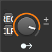

## Grid modules

[Audio Buffer](Bitwig-6.1.7/Audio%20Buffer.bwmodule) records up to 30 seconds
of stereo audio in a monophonic FX Grid. Play it at variable speeds or use a
Phase signal to write and read inside the selected region. Patch a transport
ramp to sync both heads, reverse the ramp while recording, or enable
**Keep Pitch** in the Inspector to compensate for shorter playback regions.
The waveform shows loop boundaries and the current record or playback
position. The recorded audio shapes an abstract background that moves with
playback speed.

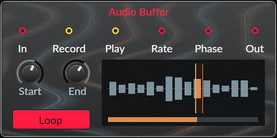

[Sonogram](Bitwig-6.1.7/Sonogram.bwmodule) shows a scrolling stereo
spectrogram from 20 Hz to 20 kHz. The display has 48 time columns and
32 logarithmic frequency bands, with a selectable time window and optional
time-frequency reassignment.

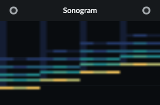

[Vectorscope](Bitwig-6.1.7/Vectorscope.bwmodule) draws a glowing XY trace
from two Grid signals or a stereo pair. The display resizes in both directions.
In the Inspector, set Persistence from 2 to 40 ms for the current trace, or
Motion Blur from 0 to 10 seconds to accumulate a fading glow over 12 × 11 cells.
The default view preserves equal axis scales. Enable Stretch in the Inspector
to fill wide or tall panels. Patch Hue to color new phosphor deposits.
Earlier colors decay and mix with new ones.

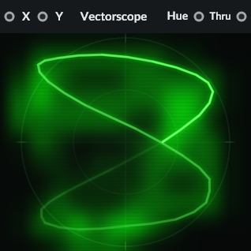

Sonogram revision 12 and Vectorscope revision 10 passed offline checks on
Bitwig Studio 6.1.7 for Windows x86-64. Live testing of these revisions is pending.

## Device gallery

### Chord Arp

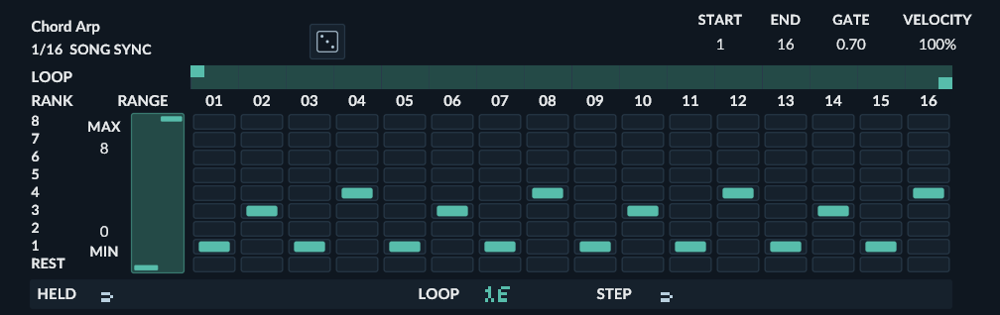

### FILAR

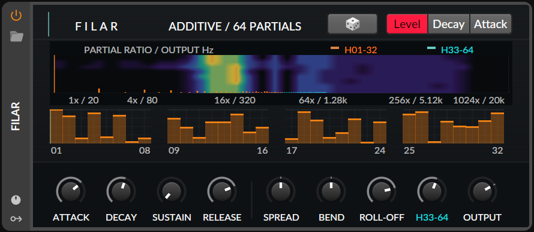

### Halftime

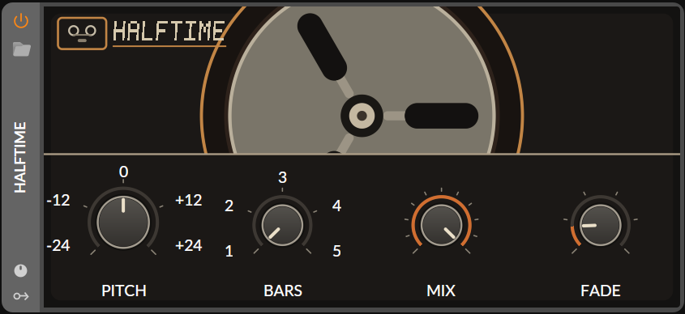

### Multiband FX-4

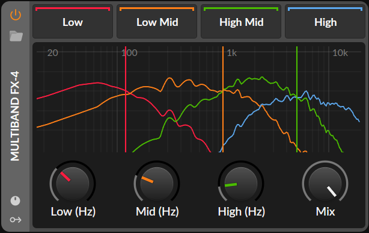

### Normalizer

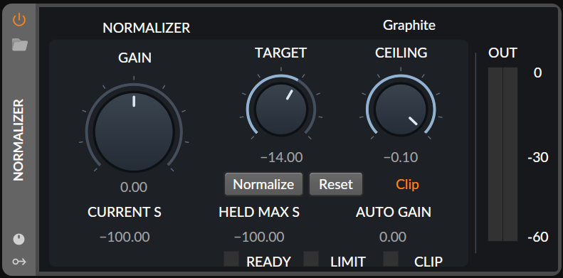

### Orbit

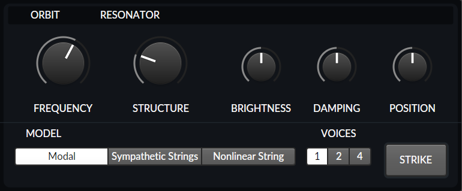

### OTT

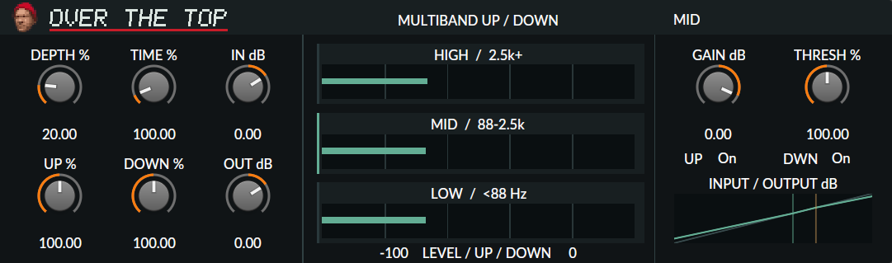

### Prism

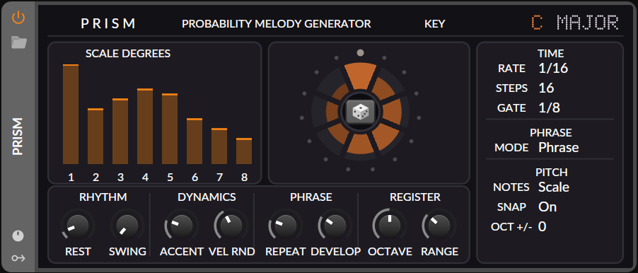

### Rivet

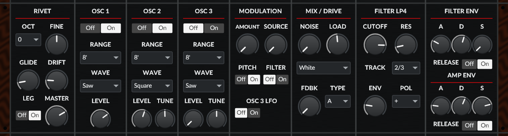

### SHARD

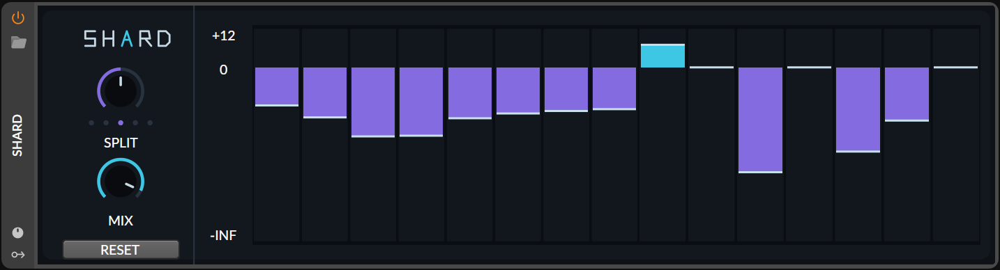

### Step Sequencer

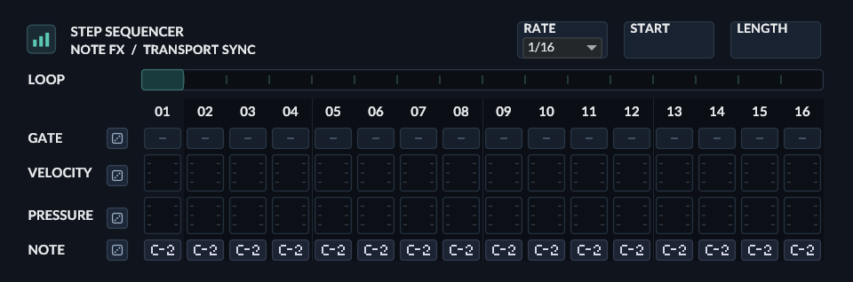

### Stutter

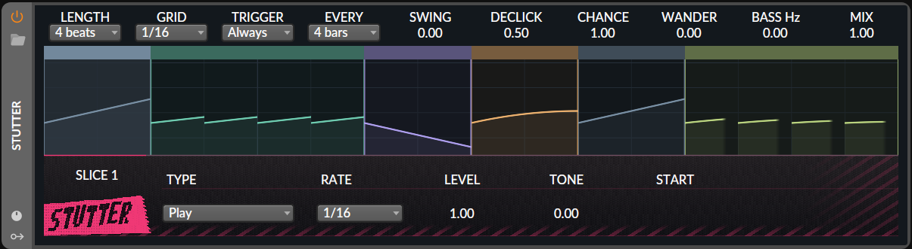

## Compatibility and updates

The original device builds passed offline checks with Bitwig Studio **6.1.3** on Windows x64. The **Custom Nitro Registration** `1.2.0-dev.5` folder scanner read their UUIDs using Bitwig's document reader. Live insertion, audio and project recall are still unverified for most builds. The current OTT file also loaded in a saved project through Patchbay on Windows 6.1.3. Gesture Loop passed its offline checks and was recognized by the same scanner. Its panel was tested in Bitwig 6.1.3 through Extension Manager; loading that build through Patchbay is unverified. See the [uncompressed builds](Bitwig-6.1.3-6.1.4/README.md) and [compressed builds](Bitwig-6.1.7/README.md) for their reader checks and remaining live tests.

The current **Chord Arp** is revision 4. Its loop endpoints use a different saved-value type from revision 1. A project saved with revision 1 failed to reopen with revision 4. For a project saved with revision 1, use its matching file from your backup or this repository's first commit. Keep a copy of the files used by your saved projects outside the scanned folders, and relaunch Bitwig through Patchbay after replacing a file.

## Build your own Bitwig device

[Bitwig Device Blueprints](https://github.com/polarity/bitwig-devices-blueprint) includes a working example and a guide to building a native Bitwig device. Point your coding agent at the blueprint repository's `AGENTS.md` to give it the build workflow and starting point for your own device.

Follow the [shared Patchbay Launcher manifest](docs/patchbay-launcher.md#devices-modulators-and-grid-modules)
when publishing device builds or adding a fork to the launcher.
